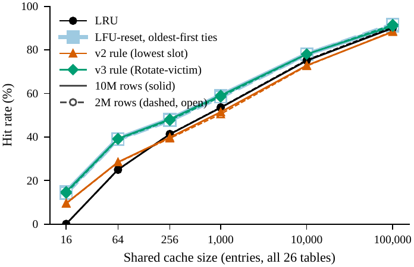
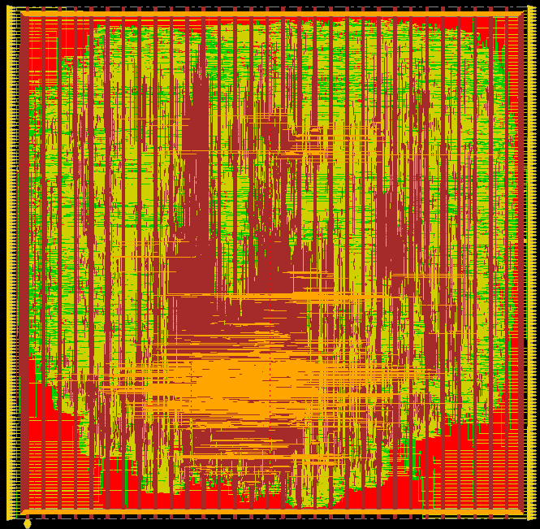
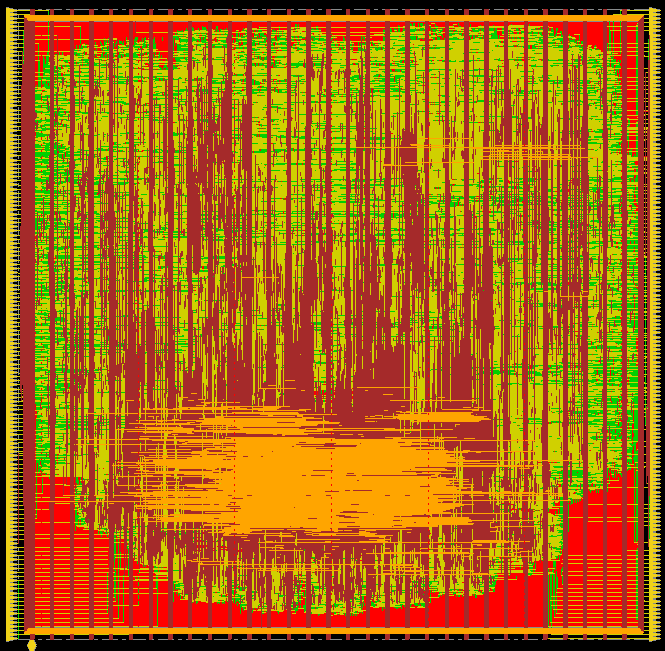

# Rotate-Victim: a tie-break fix for hardware LFU embedding caches

Recommendation models look up rows of large embedding tables for every request, and a small on-chip cache in front
of those tables saves memory traffic. This project builds such a cache in hardware with a least-frequently-used
(LFU) policy and follows it from Criteo traces to a routed layout. The finding is that one small design choice
decides whether the LFU cache beats LRU at all: when several lines share the lowest count, our comparator tree picks
the lowest index, like a priority encoder. New lines start at count one, so this fixed-index tie-break evicts the
newest line almost every time, and the cache falls below LRU. Rotate-victim fixes it with one pointer register: the
search for a victim starts just after the previous victim. With that change the hardware cache matches oldest-first
LFU, and on one cache shared by all 26 Criteo tables with 256 entries its hit rate on the first 10M rows rises from
39.8162% to 48.1592% [results/P9/SUMMARY.md]. Both versions are implemented through place and route in an
STMicroelectronics 28nm FD-SOI standard-cell library (accessed through CMP).

## Key results

Conditions: hit rates are trace-simulator results on the first 2M and 10M rows of the Criteo Display Advertising
Challenge data, validated against the RTL request by request on 200,000-request slices; timing and power are for
the typical corner only; energy depends on the testbench's fill model (0 to 3 random cycles per miss), not on a real
memory system [results/P9/SUMMARY.md, results/P13/SUMMARY.md].

- **The fixed-index tie-break loses to LRU.** In one cache shared by all 26 tables with 256 entries, the v2 rule
  (lowest index wins ties) hits 39.3685% (2M rows) and 39.8162% (10M rows), below LRU at 41.4010% and 41.2640% and
  below LFU-reset with oldest-first ties at 47.6719% and 48.1592%. On a test slice it evicts the line installed by
  the previous miss in 118,522 of 118,523 evictions [results/P9/SUMMARY.md].
- **Rotate-victim restores LFU-reset and beats LRU and v2 at every simulated size.** The v3 rule gives exactly the
  LFU-reset hits, in total and per table, at 16, 64 and 256 entries on both traces [results/P11/SUMMARY.md], and is
  within 918 hits of it from 1,000 to 100,000 entries; it beats LRU and the v2 rule at every size from 16 to
  100,000 entries [results/P9/SUMMARY.md, results/P11/SUMMARY.md].
- **Verification found zero mismatches.** The v3 RTL matches the simulator request by request in all 12 slice runs
  (0 mismatches) [results/P10/SUMMARY.md]; of the mutants, 140 were killed by the testbench and 5 by lockstep, and no
  non-equivalent mutant survived; gate-level lockstep passed 24/24 runs with 0 mismatching cycles
  [results/P11/SUMMARY.md]; post-route gate-level simulation at 1.1 ns with SDF path delays showed 0 mismatching cycles on both
  200,000-request slices; SDF timing checks were not annotated, so this is not a timing check [results/P15/SUMMARY.md].
- **Both versions meet 1.0 ns after routing at depth 256 (typical corner, 1.00 V, 25 C).** Setup slack at 1.0 ns is
  0.022 ns (v2) and 0.014 ns (v3) with no hold violations; both fail 0.9 ns [results/P15/SUMMARY.md].
- **Post-route energy per request is lower with Rotate-victim.** At a relaxed 1.1 ns clock, v3 needs 924.68 pJ
  against 1011.49 pJ for v2 on one slice (-8.58%) and 932.72 pJ against 1000.41 pJ on the other (-6.77%), because it
  takes 9.52% and 8.09% fewer cycles; its total power is 1.04% and 1.44% higher [results/P15/SUMMARY.md].
- **The routed designs are signed off at the typical corner only.** At the slow corner (0.90 V, 125 C) setup fails
  by 0.257 ns (v2) and 0.236 ns (v3) at 1.0 ns, and I/O hold checks fail because the added corners lack the clock
  latency of the typical view [results/P16/SUMMARY.md].
- **A real GPU L2 on the same stream.** On one H100, nn.EmbeddingBag over the first 2M Criteo rows (26 tables, one
  kernel per table) has an L2 read hit rate of 74.3535% at batch 64 and 56.2621% at batch 16,384 (Nsight Compute,
  no L2 flush). The GPU L2 is not an LRU or LFU cache, so this is a reference point, not a validation
  [results/P14/SUMMARY.md].

<p align="center">
  
</p>

Hit rate of one cache shared by all 26 tables, from 16 to 100,000 entries: LRU, LFU-reset with oldest-first ties,
the v2 rule (lowest index) and the v3 rule (Rotate-victim); 10M rows solid, 2M rows dashed
[results/P9/SUMMARY.md, results/P11/SUMMARY.md]. Source: `paper/v2/figs/fig_tiebreak.py`.

<p align="center">
  
  
</p>

Routed layouts of the depth-256 designs, v2 (left) and v3 (right), cropped to the layout area
[results/P15/SUMMARY.md].

## The paper

[**Rotate-Victim: A One-Pointer Tie-Break Fix for Hardware LFU Embedding Caches, from Criteo Traces to 28nm FD-SOI
Layout**](paper/v2/main.pdf)
Adarsh and Pravin Mane, Department of Electrical and Electronics Engineering, BITS Pilani, K K Birla Goa Campus.
Draft (IEEE conference format); source in `paper/v2/`. Every number in it is a macro generated from `results/` by
`tools/make_paper_macros.py`, and `make` in `paper/v2` refuses to build if a number has no source.

## Repository layout

```
rtl/               v2 (tag rtl-v2-final, lowest-index ties) and v3 (Rotate-victim) controllers with testbenches; v1_* are old and buggy
trace_sim/         trace simulators: one cache per table, one shared cache, and the RTL-exact and tie-break models
profiling/         notes on the first GPU profiling run (job output only)
synthesis/         open-tool flows (Yosys, OpenSTA, NanGate45) and gate-level and lockstep testbenches, per phase
cadence/           Genus, Xcelium and Innovus scripts for the 28nm flow (no library data)
cluster/           SLURM jobs and drivers for the Sharanga cluster, conda environment and pinned package list
tools/             result generators, table and macro builders, number and leak checkers, mutation scripts
tests/             unit tests for the simulators, the profiler and the number checker
results/<phase>/   every result, with SUMMARY.md per phase (raw outputs, tables, logs)
gem5/              older gem5 scripts and the two committed stats files (not re-run)
paper/             paper/v2: the paper source, figures and PDF
docs/              semester report, next-semester plan, open-library synthesis report, README images
```

## Phase index

Each row comes from the phase's summary file. P6 (an optional gem5 sweep) was not run. P8 has no SUMMARY.md; its
results are in `results/P8/RESULTS.md` and `results/P8/ANALYSIS.md`.

| Phase | Question | Method | Key result | Results |
|---|---|---|---|---|
| P0 | What does the cluster offer? | partition, storage and module checks | H200 and H100 partitions found; no ncu on the default path | results/P0/SUMMARY.md |
| P1 | Does the v2 controller reset or keep a slot's count on install? | COUNTER_MODE parameter, new test 7, mutation | both modes pass all 7 tests; neither keeps per-address history | results/P1/SUMMARY.md |
| P2 | Is the Criteo data complete? | figshare download, checksums, column checks | 45,840,617 rows; 0 rows without 40 columns; archive MD5 matches the published value | results/P2/SUMMARY.md |
| P3_prep | Is the trace simulator correct, and how long will it run? | unit tests and mutation on synthetic data, timing | 40 tests pass; 16/16 mutants caught; runs split per table | results/P3_prep/SUMMARY.md |
| P3 | Does LFU beat LRU with one 256-vector cache per table? | trace simulation, 2M and 10M rows | yes: LRU 67.3151%, LFU-reset 70.0951%, LFU persistent 71.8034%, Belady bound 78.6721% (2M rows) | results/P3/SUMMARY.md |
| P3b | And with one cache shared by all 26 tables? | shared-cache simulator | LFU-reset beats LRU at every size (47.6719% vs 41.4010% at 256, 2M rows); persistent LFU does not at 256 (41.0006%) | results/P3b/SUMMARY.md |
| P4 | How much of a forward pass is embedding lookup? | 26 EmbeddingBag tables and an MLP on H100 and H200, CUDA events | embedding share 0.4224-0.4553 (H100) and 0.4024-0.4358 (H200) at batch 8192; small batches are launch-bound; no counters | results/P4/SUMMARY.md |
| P5 | Area and timing of rtl/v2 in an open library? | Yosys and OpenSTA, NanGate45, pre-layout | no configuration meets 500 MHz; depth 256 reaches 167.4 MHz (mode 0) | results/P5/SUMMARY.md |
| P5b | Does a Stage-B reduction tree shorten the path? | RTL change, lockstep against the baseline | depth 16 mode 0: 203.1 to 629.2 MHz; depth 256 only 167.4 to 188.4 MHz | results/P5b/SUMMARY.md |
| P5c | A Stage-A tree; keep the per-group address copies? | tree only against tree plus copies, rule fixed in advance | copies kept on +7.44% and +5.84% Fmax at depth 256 | results/P5c/SUMMARY.md |
| P5d | Does a balanced priority tree for the hit index help? | RTL change (tag rtl-v2-final), noise floor from 8 same-logic designs | depth 256 mode 0: 213.9 to 451.2 MHz; the flow alone moves Fmax by 1.96-16.62% | results/P5d/SUMMARY.md |
| P5e | Is the flow measuring the design or itself? | new ABC script with wire loads, no RTL change | Fmax 636.1 / 603.0 / 556.6 MHz at depths 16 / 64 / 256 (mode 0); depth 256 misses 500 MHz by 0.0357 ns, inside noise | results/P5e/SUMMARY.md |
| P5f | Do the netlists behave like the RTL? | zero-delay gate-level lockstep, Yosys equivalence | 12/12 netlists with 0 mismatching cycles; 2977/2977 points proven at depth 16 | results/P5f_gls/SUMMARY.md |
| P7 | Which earlier claims hold? | every claim checked against committed files | 36 earlier claims: 15 contradicted, 16 unsupported, 4 not re-run, 1 supported | results/P7/SUMMARY.md |
| P8 | Power components of rtl-v2-final in the open library | gate-level activity, OpenSTA, clock-pin recalculation | the modes do not differ in clock-pin energy beyond the seed spread | results/P8/ANALYSIS.md |
| P9 | Why do RTL and simulator hit counts differ? | RTL-exact model, ablations, full traces | the lowest-index tie-break is the whole gap; the v2 rule loses to LRU at every size; Rotate-victim recovers 100.0% of it | results/P9/SUMMARY.md |
| P10 | Does Rotate-victim in RTL match its model? | rtl/v3, tie-order test, lockstep against the simulator | 0 mismatches in all 12 runs; depth 256 slice hits 103,382 (v3) against 81,221 (v2 rule) | results/P10/SUMMARY.md |
| P11 | Full-trace hit rate, cost and correctness of v3 | trace simulation, open-library synthesis, equivalence, gate-level lockstep, mutation | v3 equals LFU-reset; +4,921,393 hits over v2 at 64 entries (2M rows); Fmax change within the 6.44% flow variation; 24/24 gate-level runs pass | results/P11/SUMMARY.md |
| P12 | Timing and area in the 28nm library before layout | Genus, typical corner | depth 256 meets 0.8 ns and fails 0.65 ns for v2 and v3 | results/P12/SUMMARY.md |
| P13 | Gate-level match and power of the synthesized netlists | lockstep with SDF path delays, Genus power from activity | 0 mismatches; energy per request -9.08% and -7.44% for v3 (pre-layout) | results/P13/SUMMARY.md |
| P14 | How does a GPU L2 behave on the Criteo stream? | Nsight Compute on one H100 | L2 read hit rate 74.3535% (batch 64) to 56.2621% (batch 16,384), one kernel per table | results/P14/SUMMARY.md |
| P15 | Do both versions survive place and route? | Innovus, post-route gate-level simulation and power | both meet 1.0 ns and fail 0.9 ns at depth 256; energy per request -8.58% and -6.77% for v3 at 1.1 ns | results/P15/SUMMARY.md |
| P16 | Do the routed designs hold at the slow and fast corners? | timing of the P15 layouts at ss and ff, no re-optimization | no: slow-corner setup fails by 0.257 ns (v2) and 0.236 ns (v3) at 1.0 ns; I/O hold fails without per-corner clock latency | results/P16/SUMMARY.md |

## Reproducing

### What runs with open tools

Environment. Locally: Python 3 with numpy and matplotlib (the versions used are in
`results/P3_prep/venv_freeze.txt`), Icarus Verilog, Yosys 0.33, and OpenSTA built from source as recorded in
`results/P5/SOURCES.md` (the NanGate45 liberty is downloaded separately; its URL and hash are in the same file). On
the cluster: the conda environment pinned build by build in `cluster/dlrm_cache.explicit.txt` (declared in
`cluster/environment.yml`); the GPU runs used PyTorch with CUDA 12.6 as recorded in `results/P4/env_install.txt`.

```bash
# environment (conda, exact builds)
conda create --name dlrm_cache --file cluster/dlrm_cache.explicit.txt
conda activate dlrm_cache

# unit tests (torch tests are skipped without PyTorch)
python3 -m unittest discover -s tests

# trace simulation, one shared cache: LRU, LFU-reset and the other default policies, then the v2 and v3 rules
python3 trace_sim/run_shared_cache.py --criteo_path criteo/train.txt --n_rows 2000000 \
    --capacities 16 64 256 1000 10000 100000 --workers 4 --output out/shared_2M --tag default
python3 trace_sim/run_shared_cache.py --criteo_path criteo/train.txt --n_rows 2000000 \
    --capacities 16 64 256 1000 10000 100000 --workers 4 --output out/shared_2M --tag v2_v3 \
    --policies "RTL-exact mode 0" "Rotate-victim mode 0"

# trace simulation, one cache per table
python3 trace_sim/run_trace_sim.py --criteo_path criteo/train.txt --n_rows 2000000 --belady --workers 4 --output out/per_table

# RTL simulation with Icarus: v3 testbench (tests 1 to 8) at depths 16, 64, 256 and modes 0, 1; same for v2
bash rtl/v3/run_rtl.sh
bash rtl/v2/run_rtl.sh

# RTL against simulator lockstep on the Criteo slices (writes the slice files first)
python3 -I tools/p8_stream.py criteo/train.txt results/P8/stimulus
bash rtl/v3/run_p10.sh all

# open-library synthesis and timing (Yosys + OpenSTA, NanGate45, pre-layout), v2 and then v3
LIB=/path/to/NangateOpenCellLibrary_typical.lib bash synthesis/p5e/run_p5e.sh synth report
bash cluster/p11_driver.sh synth

# GPU profiling scripts (CUDA GPU with PyTorch; Nsight Compute for the counter runs)
python3 tools/profile_embedding.py --device cuda --out out/p4 --criteo_dir <dir with the per-table trace dumps>
python3 tools/p14_prep_stream.py --help
python3 tools/p14_profile.py --help
```

The cluster drivers (`cluster/p*_driver.sh`) and job files (`cluster/jobs/`) are written for the Sharanga SLURM
cluster: host names, partitions and paths in them must be changed for another site. Each phase's driver and its
exact settings are named in that phase's `SUMMARY.md`.

### What does not run without a licence

The 28nm flow (phases P12 to P16) needs a licensed design kit and Cadence Genus, Xcelium and Innovus. The scripts
are in `cadence/`; the library data, netlists, SDF and raw reports are not, and cannot be. Only aggregate tables
(`results/P12` to `results/P16`, `SUMMARY.md` and `TABLES.md`) are published, with the approval of the project
supervisor.

## Data

The Criteo Display Advertising Challenge data is not redistributed here. It was downloaded as `dac.tar.gz` from a
[figshare record](https://doi.org/10.6084/m9.figshare.5732310.v1) (the data was first released for a Kaggle
challenge); `cluster/p2_driver.sh` downloads and checks it. The checks and hashes are in `results/P2/SUMMARY.md`,
`results/P2/SOURCE.md` and `results/P2/data_hashes.txt`:

```
dac.tar.gz  SHA-256 ffb2ecbbc4ca478d2e87cc5168cca29f35a51ac5132c3a8fdea78c378c4e4c33  MD5 df9b1b3766d9ff91d5ca3eb3d23bed27
train.txt   SHA-256 f09ccdc7e76403030cd56455b8c16fde6a2ab73a9e3736a1563ffb0cd02d68fb
```

## Corrections

An earlier manuscript, an earlier Word synthesis report and earlier versions of this README quoted TSMC 28nm
synthesis numbers (area, power, timing) and several other figures for which no tool output exists, and described a
"phase transition" between LRU and LFU that the trace simulations do not support. All of these were withdrawn; the
status of each old claim is in `results/P7/CLAIMS.md`. The 28nm results above come from a different, licensed
FD-SOI library. Every number in the paper, the semester report and this README is now generated from or checked
against committed `results/` files (`tools/make_paper_macros.py`, `tools/paper_numbers_check.py --readme`).

## Citation

```bibtex
@misc{adarsh2026rotatevictim,
  author       = {{Adarsh} and Pravin Mane},
  title        = {Rotate-Victim: A One-Pointer Tie-Break Fix for Hardware {LFU} Embedding Caches,
                  from {Criteo} Traces to 28nm {FD-SOI} Layout},
  year         = {2026},
  howpublished = {Preprint},
  note         = {\url{https://github.com/idealxdxrsh/Cache-Policy-Phase-Transition-in-DLRM-Workloads}}
}
```

## License

No license has been chosen yet; there is no LICENSE file in this repository.

## Acknowledgements

We thank CMP and STMicroelectronics for access to the 28nm FD-SOI design kit, BITS Pilani K K Birla Goa Campus for
the Cadence tools and laboratory, and the Sharanga HPC facility.
